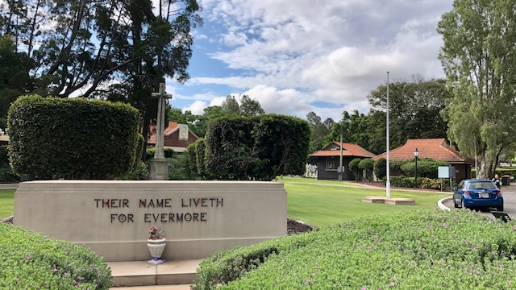
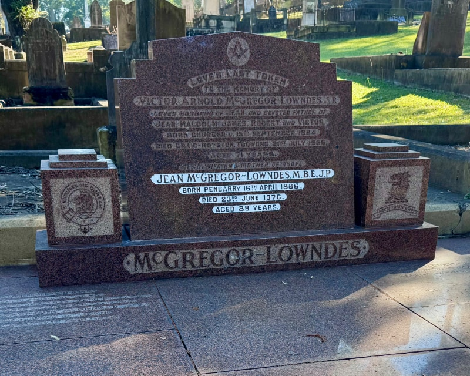
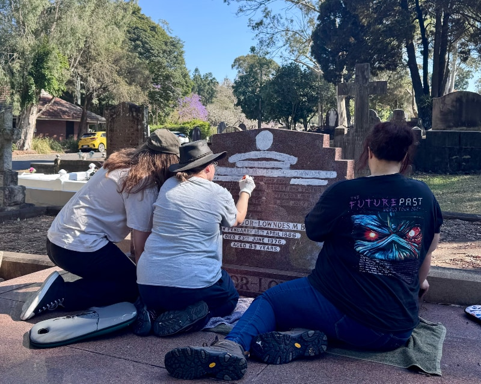
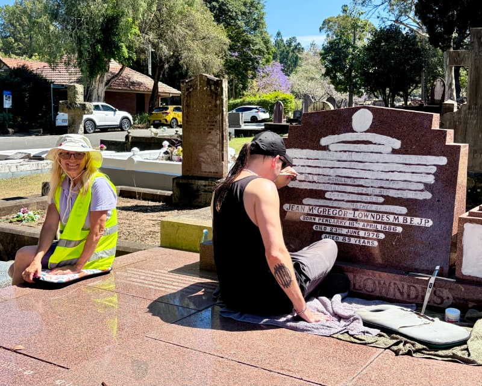
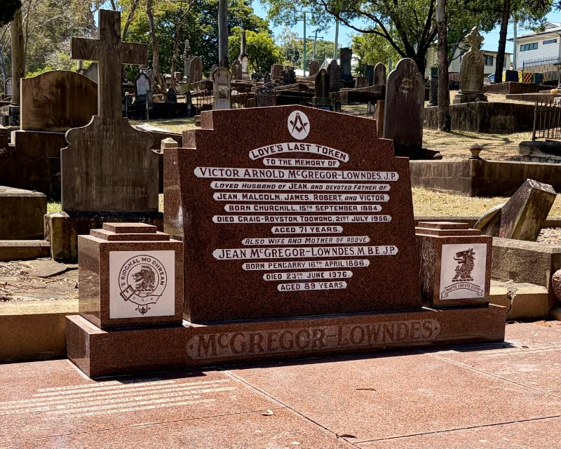
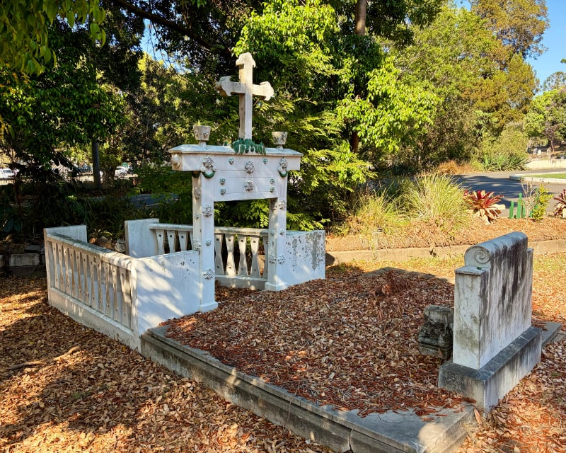
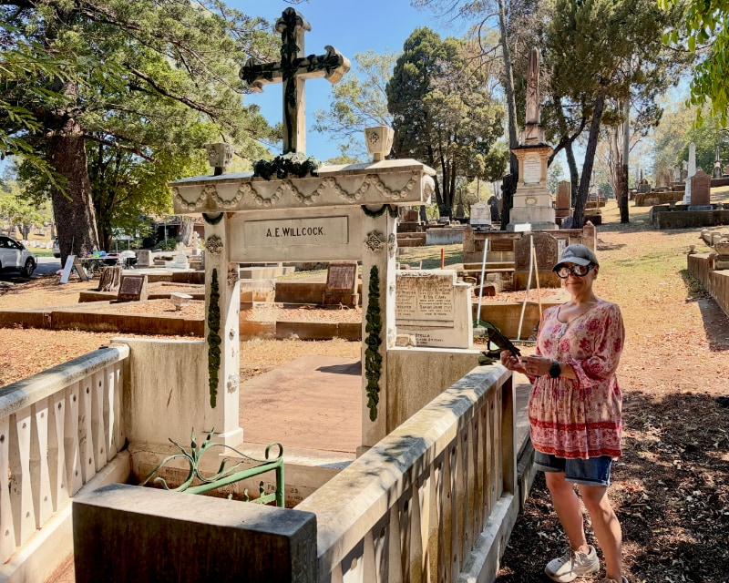

---
search:
  boost: 2
---  

# Heritage Heroes 

Friends of Toowong Cemetery run regular volunteer events to help preserve the heritage of the cemetery. 

Our next event, and last for 2026, will be on **15 November from 8:00–10:30am**. Arrive when it suits you if 8am is too early.

Meet under the flagpole in Canon Garland Place at the Toowong Cemetery near the Frederick St entrance. Parking is available inside the cemetery.

{ width="98%" data-title="Heritage Hero events start at Canon Garland Place" }

!!! Warning "What to bring"

    Wear enclosed shoes, a hat and sunscreen, and don't forget a bottle of water. We recommend bringing some gloves to protect your hands.

## Can you help?

[I want to be a Heritage Hero &nbsp; :fontawesome-solid-paper-plane:](mailto:president@fotc.au?subject=I%20want%20to%20be%20a%20Heritage%20Hero&body=Please%20keep%20me%20informed%20of%20Heritage%20Hero%20events){ .md-button .md-button--primary }

## What to expect

After you arrive:

- We'll ask you to register.
- You'll receive a safety briefing and instructions on how to clean gravesites while respecting heritage standards.
- We'll give a demonstration of re-lettering a headstone where we have received the families permission to do so. If you're interested, you can have a go under our guidance. 
- We'll share a story about one of the people remembered in the area we're caring for.
- We'll take before and after photos to show the difference you've made. You can choose if you want to be in photos. Photos may be published on our website or social media.
- We'll finish with a simple morning tea and a chat about how you'd like these events to evolve.

## Photos from our October 2026 event
{ width="49%" } { width="49%" }
{ width="49%" } { width="49%" }
<small>*Relettering a headstone - still some more work to do*</small>

{ width="49%" } { width="49%" }
<small>*Before and after gravesite cleaning. We found some green painted tin leaves that belong in the urn on top of the headstone*</small>

## Directions to Toowong Cemetery  

**[:fontawesome-solid-map: Plan your trip](../visit.md/#plan-your-trip)** &nbsp; or  &nbsp; **[:fontawesome-solid-map-marker-alt: Get directions on Google Maps](https://www.google.com/maps/dir//Toowong+Cemetery,+Frederick+St,+Toowong+QLD+4066/@-27.4770477,152.9844187,17.94z/data=!4m17!1m7!3m6!1s0x6b9150c2f0f2e23f:0xf02a35bd720a310!2sToowong+Cemetery!8m2!3d-27.4772797!4d152.984017!16zL20vMGgwczB3!4m8!1m0!1m5!1m1!1s0x6b9150c2f0f2e23f:0xf02a35bd720a310!2m2!1d152.9840719!2d-27.4772878!3e0?entry=ttu&g_ep=EgoyMDI2MDkyMC4wIKXMDSoASAFQAw%3D%3D)**

<!-- 

- Add cleaning instructions
- Add extra T&C for volunteers

-->
