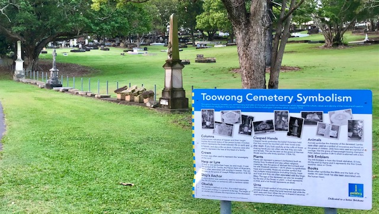

--8<-- "snippets/sem/home.json"

# Friends of Toowong Cemetery

**Friends of Toowong Cemetery is a volunteer group that discover and share the history and stories of Toowong Cemetery.**

![Toowong Cemetery main entrance][image1]{ width="32.33%" .off-glb } ![Canon Garland Place][image2]{ width="32.33%" .off-glb } ![Headstone Symbolism Display][image3]{ width="32.33%" .off-glb }

[image1]: assets/main-entrance.jpg "The main entrance to Toowong Cemetery"
[image2]: assets/flag-pole.jpg "Canon Garland Place"
[image3]: assets/symbolism-display.jpg "Headstone Symbolism Display"

<!-- Anzac and Rememberance day -->
[image4]: assets/stone-of-remembrance-with-children-1924.jpg "Remembering those who have died in the line of duty"
[image5]: assets/unveiling-cross-of-sacrifice-16x9.jpg "Remembering those who have died in the line of duty"
[image6]: assets/unveiling-memorials-1924.jpg "Remembering those who have died in the line of duty"

Heritage‑listed Toowong Cemetery is the largest cemetery in Queensland. The first burial was of **[Governor Samuel Blackall](research/samuel-wensley-blackall.md)** on 3 January 1871. Read his and hundreds of other stories about the people who shaped Brisbane, Queensland, and Australia's history.

On this site you'll find:

- **[Toowong Cemetery's history](research/history.md)** and the **[stories of people remembered here](stories/index.md)**.
- **[How to find a grave in Toowong Cemetery](find-a-grave.md)** and a **[Toowong Cemetery map](visit/#toowong-cemetery-map)**.
- **[Headstones](headstones/index.md)** including Paddington Cemetery headstones found in our **[archaeological digs](headstones/archaeological-digs.md)**.
- **[Research resources](research/index.md)** including an **[index of people in our stories](research/find-a-story.md)**.
- **[Discover upcoming events](get-involved/index.md)** and how to get involved.
- **[How to Donate](donate/)** and support our work.
- and much more.

The cemetery is maintained by the **[Brisbane City Council](https://www.brisbane.qld.gov.au/community-and-safety/community-support/cemeteries/toowong-cemetery)**.

## Things to do at Toowong Cemetery

At Toowong Cemetery you can:

- take a **[self-guided walk](visit/#self-guided-walks)** and explore the stories of people who shaped our local history.
- join us on one of our regular **[guided tours](visit/guided-tours.md)**.
- discover the meaning of **[headstone symbols](headstones/symbols.md)** at the Symbolism display.
- see **[Queensland's oldest headstones](headstones/queenslands-oldest-headstones.md)**.

<figure markdown>
  { class="full-width" }
  <figcaption markdown>Toowong Cemetery Headstone Symbolism Display</figcaption>
</figure>

<!-- Links -->

[main-entrance]: assets/main-entrance.jpg "Toowong Cemetery Main Entrance"
[Walter Hill]: research/walter-hill.md 
[Cooper]: research/lilian-cooper.md 
<!-- [Forde]: research/francis-forde.md "Read Francis' story" -->
[Forde]: https://adb.anu.edu.au/biography/forde-francis-michael-frank-12504 
[Jackson]: research/peter-jackson.md 
[Rudd]: research/arthur-hoey-davis.md "Read Steel Rudd's (Arthur Hoey Davis) story" 
<!-- [Ralston]: research/walter-ralston.md "Read Walter's story" -->
[Ralston]: https://adb.anu.edu.au/biography/ralston-walter-vardon-834
[Miller]: research/emma-miller.md 
[Heaphy]: research/charles-heaphy.md 
[Pat Hill]: research/pat-hill.md 
[Dale]: research/elizabeth-dale.md 
[Garland]: research/david-john-garland.md 
[O'Doherty]: research/kevin-izod-odoherty.md
[Brown]: research/william-walter-brown.md

<!-- include site-wide abbreviations -->

--8<-- "snippets/abbreviations.md"
