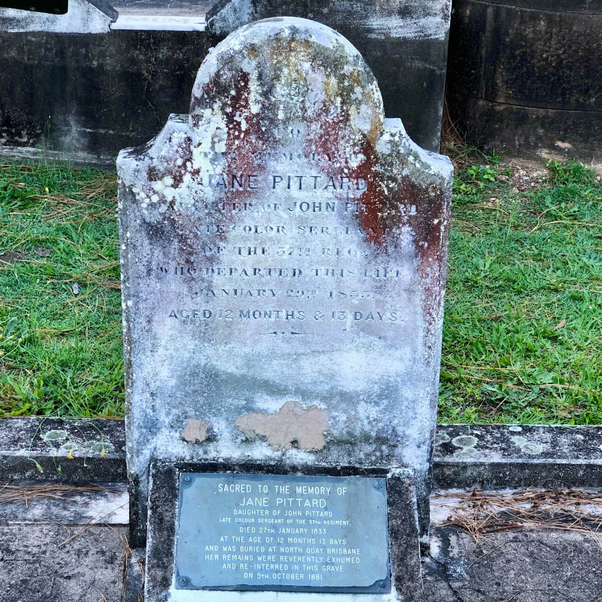

# Jane Pittard

**10 January 1832 — 27 January 1833**

--8<-- "snippets/jane-pittard.md"

### Headstone

{ width="30%" }

### Inscription

> Sacred   
> to   
> the memory of  
> Jane Pittard   
> daughter of John Pittard   
> late colour sergeant of the 57^th^ Reg  
> who departed this life   
> January 29^th^ 1833   
> Aged 12 Months & 13 Days  

### Footstone

> JP

### Plaque

> SACRED TO THE MEMORY OF   
JANE PITTARD  
DAUGHTER OF JOHN PITTARD  
LATE COLOUR SERGEANT OF THE 57^TH.^ REGIMENT,   
DIED 27^TH.^ JANUARY 1833  
AT THE AGE OF 12 MONTHS 13 DAYS AND WAS BURIED AT NORTH QUAY, BRISBANE.  
HER REMAINS WERE REVERENTLY EXHUMED  
AND RE INTERRED IN THIS GRAVE  
ON 5^TH.^ OCTOBER 1881.

--8<-- "snippets/add-to-this-story.md"