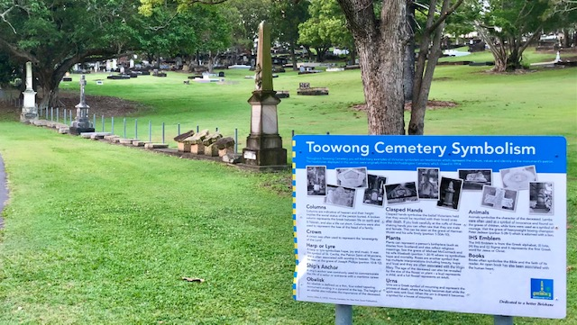
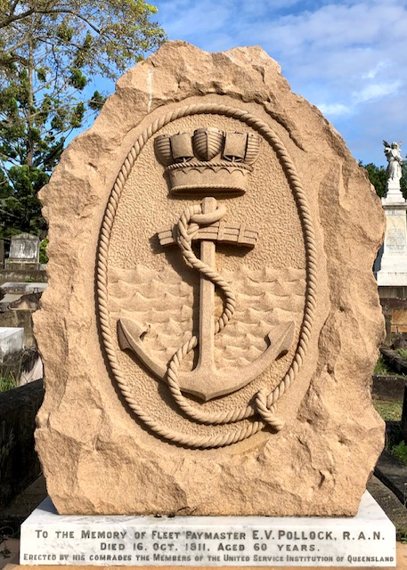
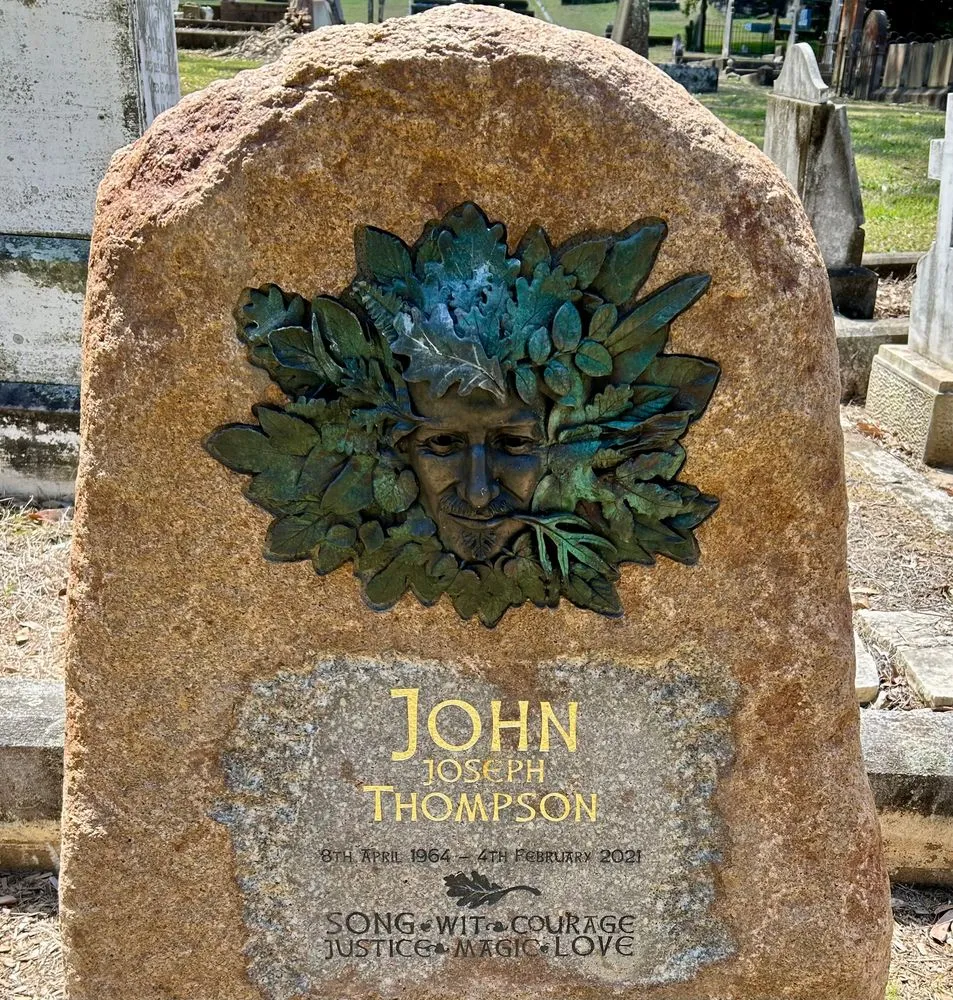

--- 
description: Learn about the hidden meaning of headstone symbols at the Toowong Cemetery Symbolism Display
---

# Toowong Cemetery Symbolism Display

In Portion 2 of the cemetery, at the [intersection of Soldiers Parade and Garland Avenue)](https://maps.app.goo.gl/yDA2J7YJrrdirAJ4A), you'll find a display of symbols on headstones. Some headstones are from the old Paddington cemetery, that were discovered in our [Archaeology Digs](../headstones/https://www.fotc.au/headstones/lost-paddington-headstones/archaeological-digs/).

The Headstones are listed from left to right. Click a name to read that person's story. 

1. William Henry Evan Morgan  :material-trumpet:{ .heart } <!-- (not Paddington) https://brisbane.discovereverafter.com/profile/31881775 -->
2. [Ernest Alexander Cairncross](../research/ernest-alexander-cairncross/)
3. [Caroline Sophia Comyn Vallack](../research/caroline-sophia-comyn-vallack/)
4. [John Mace](../research/john-mace/)
5. [Henry James Walsh](../research/henry-james-walsh/)
6. [unnamed Verney](../research/verney/)
7. [Frederick Shepperson](../research/frederick-shepperson/)
8. [Julius William Deedes](../research/julius-william-deedes/)
9. Bridget MacDuff<!--  (not Paddington) see https://bsky.app/profile/fotc.au/post/3lulf24voxp2j and https://brisbane.discovereverafter.com/profile/31773272 -->
10. [John Brougham Copeland](../research/john-brougham-copeland/)
11. [Ernest Victor Williams](../research/ernest-victor-williams/)
12. [Harry Dobbin Shepperson](../research/harry-dobbin-shepperson/)
13. Dora
14. [Algernon Guthrie Mylne](../research/algernon-guthrie-mylne/)
15. [Vokes Sinclair Dudgeon](../research/vokes-sinclair-dudgeon/)
16. [Henry Joseph Thomas](../research/henry-joseph-thomas/)
17. Empty space 
18. [Ernest Elphinstone Dalrymple](../research/ernest-george-beck-elphinston-dalrymple/) :fontawesome-solid-crown:{ .heart }
19. George Darby Blanche  :fontawesome-regular-book:{ .heart } <!-- ](../research/george-darby-blanche/) --> 
20. [IHS symbol](../headstones/symbols/#ihs-emblem) :fontawesome-solid-dollar-sign:{ .heart }
21. [Julius Kopp](../research/julius-kopp/)  :fontawesome-solid-music:{ .heart }
22. [Andrew S Ferguson](../research/andrew-s-ferguson/), Jessie Manwaring, and Samuel Manwaring
23. Francis Downes :fontawesome-solid-anchor:{ .heart } <!-- (not Paddington) https://brisbane.discovereverafter.com/profile/31877981 -->

 

[Learn more about headstone symbols in Toowong Cemetery](../headstones/symbols/){ .md-button .md-button--primary }

 

{ width="33.75%" class="full-width" loading=lazy } { width="45%" class="full-width" loading=lazy }
